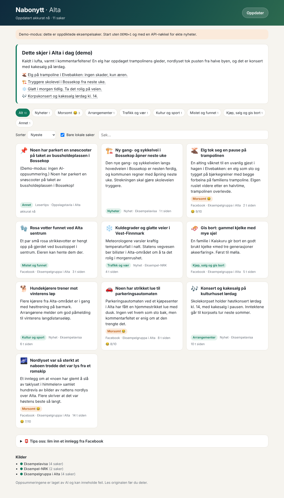

# Nabonytt

A local news feed for your town. Nabonytt collects news articles (RSS) and posts from local Facebook pages and community groups, then uses Claude to write short summaries in Norwegian. Each item gets a category, a "fun score" and a "how local is this" score, and the app writes a daily digest, "Dette skjer i Alta i dag". It is set up for **Alta, Finnmark** out of the box.



## Run it

```bash
npm install
export ANTHROPIC_API_KEY=sk-ant-...
npm start               # http://localhost:3000
```

To try the UI without an API key or network access, run `npm run demo`. It uses made-up sample stories.

The server fetches all sources on startup and again every `refreshMinutes` (30 by default). It only summarises new items, so each item costs one API call once. Results are stored in `data/store.json`, and items older than 14 days are removed.

| Env var | Purpose |
|---|---|
| `ANTHROPIC_API_KEY` | Claude API key (required outside demo mode) |
| `CLAUDE_MODEL` | Defaults to `claude-opus-5-5`. Set `claude-haiku-5-5` for a much cheaper feed. |
| `FB_ACCESS_TOKEN` | Graph API token for the Facebook *pages* listed in config |
| `FB_GRAPH_VERSION` | Graph API version, default `v23.0` |
| `PORT` | Default `3000` |
| `DEMO=1` | Use sample data, no API calls |

## Publish on GitHub Pages

GitHub Pages only serves static files, so the Pages version is rebuilt by GitHub Actions (`.github/workflows/pages.yml`). Every hour, and on each push to `main`, the workflow:

1. fetches all feeds;
2. summarises new items with Claude;
3. publishes the site with the feed as `feed.json`.

Summaries are kept between runs in the Actions cache, so each item is only summarised once.

1. In the repo, go to **Settings → Pages → Source** and choose **GitHub Actions**.
2. Under **Settings → Secrets and variables → Actions**:
   - add the secret `ANTHROPIC_API_KEY`. Without it, the site deploys with demo data.
   - optionally add the secret `FB_ACCESS_TOKEN` and the variable `CLAUDE_MODEL`.
3. Run the workflow from the **Actions** tab, or push to `main`.

The static site has no "Oppdater" button and no "Tips oss" form, since those need the server. Community posts appear only as their AI summary; the raw post text is not published. Don't commit Facebook exports to a public repo: `data/facebook-import/*.json` is git-ignored for that reason. To use the tips form, run the Node server instead (see "Run it").

## Sources

Edit `config/sources.json` to change the town, the nearby place names that count as local, and the feeds.

**News (RSS).** Ships with a Google News search for "Alta Finnmark", NRK Troms og Finnmark, Altaposten and Kronstadposten. Any RSS/Atom URL works. If a feed URL is wrong or blocked, it shows up red under "Kilder" at the bottom of the page and the other sources keep working. NRK covers the whole county, so Claude's `localScore` filters out stories that aren't about Alta when "Bare lokale saker" is ticked.

**Facebook.** Facebook does not offer a way to read groups automatically: the Groups API was shut down in 2024, and scraping breaks Facebook's terms. So:

- **Groups such as "Oppslagstavla i Alta"** can come in two ways:
  - the **📮 Tips oss** form in the app, where anyone can paste a post they found funny or useful;
  - JSON files dropped into `data/facebook-import/`. Copy `example.json.sample` to see the format. Common export shapes (`text`/`message`, `url`, `time`) are recognised, so you can feed in exports from a tool you are allowed to use.
- **Public Facebook pages** (for example the municipality, police or local businesses) can be read with the Graph API. Add `{ "name": "...", "id": "<page id or username>" }` to `facebook.pages` and set `FB_ACCESS_TOKEN`. Reading pages you don't manage needs a Meta app approved for *Page Public Content Access*.

Posts in community groups are written by private people. The prompt tells Claude not to put names, phone numbers or addresses of private individuals into headlines or summaries. "Les original" links back to the post.

## How it works

```
src/
  server.js          Express API + static frontend, refresh timer
  feed.js            the JSON the frontend renders (also used for the static build)
  pipeline.js        fetch all sources → store new items → summarise → digest
  ai.js              Claude calls (structured JSON output, batches of 12)
  sources/rss.js     RSS/Atom via rss-parser
  sources/facebook.js  Graph API pages + JSON imports
  store.js           JSON-file store
  demo-data.js       sample data for DEMO=1
public/              vanilla HTML/CSS/JS frontend
scripts/build-static.js  one refresh → dist/ for GitHub Pages
```

- `GET /api/feed`: items, digest and source status.
- `POST /api/refresh`: fetch and summarise now.
- `POST /api/tips` `{ text, source?, url? }`: add and summarise a pasted post. Limited to 10 per IP per hour.

Claude calls use structured outputs, so responses always parse as JSON. They run at `effort: "low"` for item summaries and `"medium"` for the digest, with `fallbacks: "default"`, so a request Claude declines is retried on a fallback model server-side. A batch that fails is retried on the next refresh, up to 3 times per item.

## Taking it further

- Point it at another town: change `location` and the feeds in `config/sources.json`. The prompts use those values.
- Deploy it on any Node 20+ host (Render, Fly.io, a Raspberry Pi). Persist the `data/` directory.
- Ideas: push notifications for high fun-score posts, a weekly email digest, or a map using place names from the summaries.
